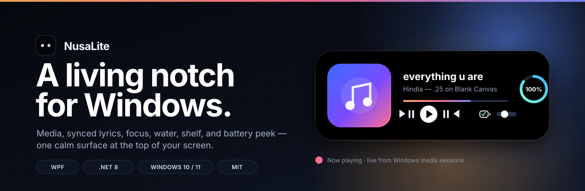
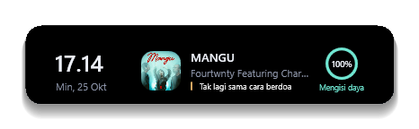
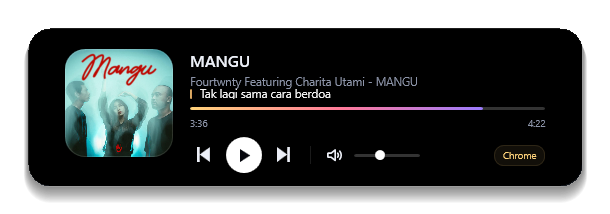

<div align="center">
  
</div>

<h1 align="center">NusaLite</h1>

<p align="center">
  <strong>Dynamic island untuk Windows.</strong><br/>
  Media, lirik tersinkron, fokus, air, shelf, dan battery peek dalam satu permukaan yang tenang.
</p>

<p align="center">
  
  
  
  
  
</p>

<p align="center">
  <a href="#mulai-cepat">Mulai cepat</a> ·
  <a href="#fitur">Fitur</a> ·
  <a href="#arsitektur">Arsitektur</a> ·
  <a href="#roadmap">Roadmap</a>
</p>

---

## Kenapa NusaLite?

NusaLite adalah notch hidup di bagian atas layar Windows. Ia muncul saat dibutuhkan, lalu mengecil kembali tanpa mengganggu pekerjaan. Tidak ada jendela besar, tidak ada Electron, dan tidak ada dashboard yang harus dibuka.

Dibangun native dengan **WPF + .NET 8**, NusaLite memakai media session Windows, Core Audio, dan API lirik publik untuk menghadirkan informasi yang relevan tepat di atas layar.

## Tampilan

<p align="center">
  
  
</p>

<p align="center">
  <sub>Ringkasan harian dan pemutar media, langsung dari Windows media session.</sub>
</p>

## Fitur

| Fitur | Deskripsi |
| --- | --- |
| **Dynamic island** | Notch di atas layar yang membesar saat hover dan mengecil saat tidak dipakai. |
| **Media session** | Membaca lagu yang sedang diputar dari Spotify, browser, atau aplikasi lain lewat Windows SMTC. |
| **Kontrol pemutar** | Play/pause, next/previous, progress, volume, dan indikator sumber pemutar. |
| **Lirik tersinkron** | Lirik dari [LRCLIB](https://lrclib.net) dengan tampilan prev/current/next dan offset `-` / `+`. |
| **Artwork cerdas** | Artwork dari media session, dengan fallback Deezer lalu iTunes untuk source browser. |
| **Fokus** | Timer Pomodoro dengan sesi fokus, jeda, reset, dan skip. |
| **Air** | Target minum harian, tambah 250 ml, reminder, dan grafik 7 hari terakhir. |
| **Shelf** | Tarik file atau folder ke Shelf untuk akses cepat, maksimal 12 item per sesi. |
| **Peek** | Notifikasi ringkas untuk perubahan volume, status daya, dan media. |
| **Tray menu** | Buka setiap view, sematkan di layar, aktifkan autostart, atau keluar. |
| **Autostart** | Daftarkan NusaLite ke Windows Run key langsung dari tray menu. |

## Mulai cepat

### Prasyarat

- Windows 10 versi 1809+ atau Windows 11
- [.NET 8 SDK](https://dotnet.microsoft.com/download/dotnet/8.0)

### Build dan jalankan

```powershell
git clone https://github.com/Pidzzzz/nusa-lite.git
cd nusa-lite
dotnet build -c Release
dotnet run -c Release
```

Atau langsung dari Visual Studio / Rider dengan membuka `NusaLite.csproj`.

### Publish

```powershell
dotnet publish NusaLite.csproj -c Release -r win-x64 --self-contained false
```

## Cara pakai

- **Hover** notch untuk membuka ringkasan.
- **Klik** notch untuk membuka pemutar.
- **Scroll** di atas notch untuk mengatur volume.
- **Klik kanan ikon tray** untuk membuka Ringkasan, Pemutar, Lirik, Fokus, Air, atau Shelf.
- **Tarik file/folder** ke Shelf untuk menyimpannya sementara.
- **Sematkan di layar** dari tray menu agar island tetap terbuka.
- **Mulai bersama Windows** dari tray menu untuk mengaktifkan autostart.

## Arsitektur

```text
NusaLite/
├─ AppHost.cs              # komposisi service, tray, view model, dan window
├─ MainWindow.xaml         # overlay transparan + animasi island
├─ Views/                  # Hub, Player, Lyrics, Focus, Water, Shelf, Peek, Idle
├─ ViewModels/             # state aplikasi dan orkestrasi data
├─ Services/               # media, lirik, artwork, power, pomodoro, water, shelf, tray
├─ Controls/               # NotchShape, ArcRing, EqBars, LyricTicker
├─ Interop/                # Win32, Core Audio, window styling
├─ Infrastructure/         # decoder, converter, logging, observable base
└─ Themes/                 # style dan resource visual
```

### Alur data

```text
Windows SMTC ──► MediaService ──► MainViewModel ──► Views
                     │                  │
                     ├─► ArtworkService │
                     └─► LyricsService  └─► TrayService / SettingsStore
Core Audio ─────────► AudioService
Power / Pomodoro / Water / Shelf ─────► MainViewModel
```

## Tech stack

- **WPF** untuk overlay, animasi, dan seluruh UI.
- **Windows.Media.Control** untuk membaca dan mengontrol media session.
- **Core Audio API** untuk volume dan mute.
- **LRCLIB** untuk lirik tersinkron.
- **Deezer + iTunes Search API** untuk fallback artwork.
- **WinForms NotifyIcon** untuk tray menu dan autostart.
- **System.Text.Json** untuk settings lokal di `%APPDATA%\NusaLite\settings.json`.

## Roadmap

- [ ] Persistensi item Shelf setelah restart.
- [ ] Dukungan multi-monitor dan DPI campuran.
- [ ] Pilihan tema dan aksen.
- [ ] Pengaturan durasi Pomodoro dan target air dari UI.
- [ ] Dukungan source lirik tambahan.
- [ ] Installer dan build release otomatis.

## Kontribusi

Kontribusi, ide, dan laporan bug sangat diterima. Silakan buka issue atau kirim pull request.

1. Fork repository.
2. Buat branch fitur: `git checkout -b feat/nama-fitur`.
3. Commit perubahan: `git commit -m "feat: ..."`.
4. Push branch dan buka pull request.

## Lisensi

Dirilis di bawah [MIT License](LICENSE).

---

<p align="center">
  Dibuat untuk Windows yang terasa sedikit lebih hidup.
</p>
